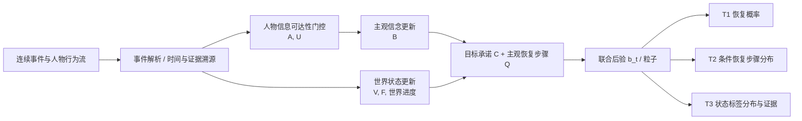

# 技术方案（竞赛版）

> **赛道**：第八届全球校园人工智能算法精英大赛 · 算法创新赛 · 赛题 1「算法模型创新」
> **状态**：写作骨架 + 技术要点草稿，**不是最终提交稿**。所有实验数字均待真实运行后填写。
> **最终格式**：按官方模板导出 PDF，≤10MB；提交前删除本框与所有 TODO。

---

## 0. 作品名称与简介

**候选作品名称**：ECR-MWM：跨中断心智世界模型（17 字，待团队确认，最终不超过 20 字）

**候选作品简介（草稿，目标 ≤300 字）**：

> 针对外部观察者在任务中断后难以判断人物是否恢复原目标、从哪一步恢复的问题，本项目拟提出认知可达性约束的动态心智世界模型 ECR-MWM 及联合状态滤波器 EC-JMF。方法分离客观事实、人物接触证据、主观信念、目标承诺与恢复进度，通过事件级概率更新和反事实一致性约束，预测恢复事件与恢复步骤。计划在受控最小对照集及经授权的真实行为数据上，与完整历史推理、BDI、滑窗目标识别和 MENTIS 等基线比较，报告恢复 F1、步骤准确率、概率校准与推理成本。当前为研发方案，结论以最终实验为准。

---

## 一、项目概述

### 1.1 项目背景与意义

任务中断普遍存在于办公协作、日常服务、智能助手与具身智能场景。中断结束后，一个外部观察者（例如辅助型智能体）通常只能看到部分事件与行为，却需要判断：现实目标是否仍然有效、人物是否知道关键事实、人物是否仍承诺原目标、任务进行到哪一步，以及人物接下来会**是否恢复、从哪一步恢复**。

现有人工智能体可以表示目标、意图与动作条件化状态，但在“外部观察者 + 部分可观测 + 跨中断”的设定下，仍缺少对以下因素的联合推断：

- 客观事实与人物所知之间的差异（例如订单已取消，但人物未看到通知）；
- 人物的目标承诺状态（继续、暂挂、放弃、认为已完成）；
- 人物主观认为的恢复步骤，与客观最优步骤可能不同；
- 恢复事件与恢复步骤的联合、概率化预测与校准。

本项目拟研究这一问题，并把它落实为一个可训练、可调用、可消融的算法模型，而不是仅增加若干状态字段或提示词。

### 1.2 问题定义

设人物正在执行原目标 `g`，任务步骤图为 `G=(K,D)`。外部观察者在截止时刻 `t` 获得事件历史：

$$
X_t=(g,G,O_{1:t},t,H),\qquad O_{1:t}=\{e_1,\ldots,e_t\},
$$

其中 `H` 为预测窗口（首版为未来 `H` 个决策机会）。模型输出：

1. **T1 恢复事件**：`P(resume within H | X_t)`；未来观察不足时记为 `censored`，不强行预测“放弃”。
2. **T2 恢复位置**：在恢复发生条件下，首个原目标相关且尚未完成步骤的条件分布 `P(Q^*=k | resume, X_t)`。
3. **T3 状态信念**：对 `V/F/A/B/C/Q` 输出离散分布与证据引用；未知时不得伪造确定标签。

“恢复”的操作性定义：人物先前确实开始过 `g`，中断期间停止推进并转向其他活动，在 `t` 之后首次出现可归属于 `g`、推动尚未完成步骤的**实际行为**。仅再次谈起目标、返回原地点或心里想做，不自动算作行为恢复。

### 1.3 赛题方向定位

- **主类别**：算法模型优化与突破——大模型与智能体、序列状态推断、语义理解、概率化推理、决策预测。
- **可扩展类别**：具身智能/机器人中的人类状态预测（需相应实验后才能写入实际贡献）。
- **不作为主类别**：单纯行业应用或仅依靠新增数据字段的系统开发。

### 1.4 拟交付贡献

| 编号 | 贡献 | 性质 | 当前状态 |
|---|---|---|---|
| C1 | 定义“外部观察者下的跨中断恢复预测”任务、标签与评测协议 | 任务/数据贡献 | 方案与 schema 草案 |
| C2 | 提出并实现信息可达性约束的联合状态更新器 EC-JMF | 核心算法贡献 | 未实现 |
| C3 | 联合预测恢复事件、恢复步骤与状态不确定性 | 方法功能 | 未实现 |
| C4 | 公开可复核的事件流、标签证据、基线、消融、成本与失败案例 | 可复现贡献 | 脚手架 |

**口径**：C2 是核心算法贡献；C1/C4 是使算法可验证的支撑贡献。不能把任务/数据贡献冒充算法创新，也不能在实验前宣称性能优势。

---

## 二、算法模型设计

### 2.1 总体架构

### 2.2 状态因子化

联合状态 `Z_t=(V_t,F_t,A_t,B_t,C_t,Q_t)`：

| 因子 | 含义 | 标签 |
|---|---|---|
| `V` | 客观目标有效性 | `VALID / CANCELLED / FULFILLED / UNKNOWN` |
| `F` | 客观执行可行性 | `READY / BLOCKED / UNKNOWN` |
| `A` | 人物接触证据 | `ACCESSED / NOT_ACCESSED / UNCERTAIN` |
| `B` | 人物主观信念 | `BELIEVES_VALID / BELIEVES_INVALID / UNRESOLVED / UNKNOWN` |
| `C` | 目标承诺 | `ACTIVE / SUSPENDED / ABANDONED / COMPLETED / UNKNOWN` |
| `Q` | 主观恢复步骤 | `step_id / UNKNOWN / NOT_APPLICABLE` |

在转移时额外使用内部辅助潜变量 `U_t`（未接触 / 接触未理解 / 接触且理解）与交付证据 `D_t`；`U_t` 不作为真实认知标签输出，也不替代六维接口。

**关键约束**：`V/F` 是客观状态；`B/C/Q` 是人物状态。客观取消不能直接复制为人物的“已取消”信念；人物接触通知也不等于理解或采信。

### 2.3 事件级联合转移

事件编码：

$$
\mathbf h_t=\mathrm{Enc}_{\phi}\left(e_t,\mathrm{source}_t,\Delta t,\mathcal G,\mathrm{evidence}_t\right).
$$

拟实现的因子化转移：

$$
\begin{aligned}
&T_{\theta}(z_t,u_t\mid z_{t-1},e_t,D_t,\mathcal G) \\
&=T_{\theta}^{W}(V_t,F_t\mid V_{t-1},F_{t-1},E_t^{world})\\
&\quad\cdot T_{\theta}^{AU}(A_t,U_t\mid A_{t-1},D_t,\mathbf h_t)\\
&\quad\cdot T_{\theta}^{B}(B_t\mid B_{t-1},U_t,\widetilde e_t^{person})\\
&\quad\cdot T_{\theta}^{C}(C_t\mid C_{t-1},B_t,Q_{t-1},\xi_t^{person})\\
&\quad\cdot T_{\theta}^{Q}(Q_t\mid Q_{t-1},C_t,B_t,\mathcal G_t^{person}).
\end{aligned}
$$

其中 `\widetilde e_t^{person}`、`ξ_t^{person}`、`\mathcal G_t^{person}` 只能使用人物当时可获得的信息。

接触/理解门控：

$$
\pi_t(a,u)=\mathrm{softmax}\left(f_{\theta}^{AU}(\mathbf h_t,D_t,a_{t-1})\right),
$$

$$
P(B_t\mid B_{t-1},e_t,D_t)=\sum_{a,u}\pi_t(a,u)\,T_{\theta}^{B}\left(B_t\mid B_{t-1},\widetilde e_t^{person}(a,u)\right).
$$

“未接触”不意味着永不更新：若存在独立可见线索或可观察行为，仍可更新人物信念；但不能因为观察者看到了后台取消消息，就把该消息当成人物看到的输入。

### 2.4 推断：粒子滤波与后验修正

EC-JMF 维护 `N` 个粒子 `{(z_t^(i), w_t^(i))}`。每个事件先传播世界状态与人物心智候选，再以截至 `t` 的实际行动作为似然更新权重：

$$
\widetilde z_t^{(i)},u_t^{(i)}\sim T_{\theta}(\cdot\mid z_{t-1}^{(i)},e_t,D_t,\mathcal G),
$$

$$
\widetilde w_t^{(i)}\propto w_{t-1}^{(i)}\cdot p_{\theta}\left(O_t^{act}\mid \widetilde z_t^{(i)},\mathcal G\right),
\qquad
w_t^{(i)}=\frac{\widetilde w_t^{(i)}}{\sum_j\widetilde w_t^{(j)}}.
$$

计算有效粒子数 `ESS=1/Σ(w_i²)`；低于开发集阈值时重采样。首版先在小状态空间用精确枚举/HMM 校验粒子输出，再接神经转移。**SMC 是已有工具，不是本项目原创性来源**；推断时 SMC 不能冒充端到端可微训练。

输出头从过滤后的联合后验产生：

$$
\widehat p_{t,H}=\sum_i w_t^{(i)}\,p_{\psi}\left(Y_{t,H}=1\mid z_t^{(i)},\mathcal G,H\right),
$$

$$
\widehat q_{t,H}(k)=P\left(Q^*=k\mid Y_{t,H}=1,O_{1:t}\right).
$$

### 2.5 训练目标与反事实约束

拟采用的分阶段目标：

$$
\mathcal L=
\mathcal L_{state}^{masked}
+\lambda_r\mathcal L_{resume}
+\lambda_q\mathcal L_{step}^{masked}
+\lambda_i\mathcal L_{inv}
+\lambda_s\mathcal L_{semantic}
+\lambda_k\mathcal L_{knowledge}.
$$

| 目标项 | 作用 | 关键约束 |
|---|---|---|
| `L_state^masked` | 对有证据支持的状态标签作分类 | 无可靠标签时逐因子掩码 |
| `L_resume` | 恢复事件预测 | P0 脚本标签与 P1 真实标签分开 |
| `L_step^masked` | 恢复步骤条件分类 | 只对确实恢复且步骤可辨认的样例计算 |
| `L_inv` | 信息等价对照的 JS 一致性 | 只约束人物心智后验，不约束客观 `V/F` |
| `L_semantic` | 任务图/完成顺序/状态冲突 | 硬约束只用于逻辑必不可能的情况 |
| `L_knowledge` | 未经支持的知识跳变处罚 | 不把“行为反常”设为绝对违规 |

信息等价约束：

$$
\mathcal L_{inv}=D_{JS}\left(b^{ment}_{\theta}(h),b^{ment}_{\theta}(h')\right),
\qquad h\sim_{person}h'.
$$

两类最小对照：

- **类型 I（信息等价）**：世界事实不同，但人物可获得信息与可观察行动相同；不应仅因不可见世界变化而改变人物心智后验。
- **类型 II（人物信息变化）**：世界事实相同，人物收到/理解可信消息与未获知不同；应按证据产生合理差异，但不强制行动标签必然变化。

### 2.6 与直接竞争工作的差异

> 初步对照，完整原文核查与引用格式待 B 补齐；不得使用“首次提出”类表述。

| 工作 | 已有什么 | 本项目不能宣称 | 本项目拟实现的差异 |
|---|---|---|---|
| MWM / MENTIS 2026 | 物理—心智联合状态、动作条件化转移 | 首次把目标/意图加入世界模型 | 跨时刻联合信念、认知访问控制、恢复点追踪 |
| Memory for Goals / Borst | 目标激活、干扰、恢复成本 | 首次研究意图衰减/恢复 | 把认知线索作为状态更新约束/特征 |
| BDI 2008 | 挂起、重新考虑、计划恢复 | 首次设计 active/suspended/cancelled | 从外部观察推断隐藏状态 |
| 2017 滑窗目标识别 | 滑窗目标切换、旧任务恢复案例 | 首次识别目标切换与恢复 | 保留暂挂目标，区分取消/完成/不可执行/未获知 |
| SIPS 2020 | 目标/计划后验、粒子滤波 | 首次概率化推断目标 | 学习信息通道 + 承诺 + 恢复步骤联合转移 |
| 2024 goal solvability | 动作、时间、目标可达性 | 首次考虑目标可行性 | 区分客观可行与人物认知到的可行 |
| GODR 2026 | 运行时目标生命周期、恢复契约 | 首次设计恢复契约/恢复点 | 由不完整外部证据推断人物主观状态 |

核心差异集中在 **C2-a 认知可达性约束的联合状态转移**、**C2-b 跨中断承诺—主观恢复步骤联合滤波**、**C2-c 人物信息等价反事实一致性学习**。三者的有效性必须由本项目自己的基线、消融与真实数据证明。

### 2.7 训练与实现起步配置

| 组件 | 起步选择 | 备注 |
|---|---|---|
| 输入 | 结构化 JSON 事件 | 文本 LLM 解析需单独报告解析准确率与 token 成本 |
| 编码 | 事件类别 embedding + 时间/来源/接触标志 + 小型 MLP | 可先用冻结语言特征 |
| 转移 | `T^W/T^AU/T^B/T^C/T^Q` 分类分布 | 小规模因子共享底座 |
| 推断 | 精确枚举校验 + SMC（`N=64/128` 起步） | 记录 ESS、重采样、时延与粒子数敏感性 |
| 预测窗口 | 首版 `H=3` 个决策机会 | 多窗口 1/3/5 为后续 |
| 校准 | 开发集选超参，独立校准集温度缩放 | 报告 Brier/ECE 与样本量 |
| 停止复杂化 | 与全历史/结构化提示/BDI/普通 HMM-SMC 持平则优先简化 | 不堆网络层或损失项 |

以上均为开发起点，不是已调优参数或实验结果。

---

## 三、实验验证与应用

> **当前状态：尚无实验结果。** 以下表格中的数字必须由真实运行填写；在此之前不得对外提交。

### 3.1 数据

| 数据 | 设计 | 当前状态 | 竞赛用途 |
|---|---|---|---|
| P0 受控诊断集 | 120 个基础故事家族、≥240 条最小对照；三领域 | 已完成：120 家族 / 240 条、1831 个事件；`p0-record/v0.2.0`；8 个受控机制各 15 家族；`split` 72/24/24；`annotation.status=reviewed`；结构与跨字段校验通过。另有 7 家族 / 14 条不确定性候选批次（`draft`，待复核） | 协议诊断、泄漏测试、消融 |
| P1 真实行为数据 | 经许可的连续行为/任务日志；双人标注；删失处理 | 未采集 | 真实恢复预测；当前只能作为未来工作 |

当前 P0 数据位于 `data/p0/p0_samples_v0.2.json`，覆盖 `work` 80 条、`collaboration_service` 84 条、`daily_life` 76 条。`python scripts/validate_data.py` 输出 240/240 通过，15 个未来泄漏家族截断前输入一致；B 已完成人工复核（`reviewed`），A/C 盲审尚未完成，也尚未运行任何模型。

覆盖度审计（`python scripts/p0_quality_report.py`，数字全部由数据实算）发现：240 条虽然达到规模目标，但 schema 声明的取值里有 12 个一次都没出现，其中 11 个是承载不确定性的档位（`A=UNCERTAIN`、事件级 `person_access=UNCERTAIN`、`person_comprehension∈{NOT_UNDERSTOOD,UNCERTAIN}`、`certainty∈{PROBABLE,UNCERTAIN}`、`V/F=UNKNOWN`、`B=UNRESOLVED`、`C∈{ACTIVE,UNKNOWN}`）。这批取值正是本课题要建模的认识处境，缺它们等于让模型只在"一切都确定"的世界学习。`data/p0/p0_samples_v0.3.json`（7 家族 / 14 条，`scripts/build_p0_uncertainty.py` 可复现生成）已把 11 个档位全部覆盖，合并后仅剩 `split.calibration` 待与 C 定协议；该批次当前是 `draft`（`annotator_id=agent-draft`），B 复核完成前不作为已验收数据，也不进入任何实验结论。

**重要缺口**：竞赛要求“真实有效的实验数据”。当前 240 条 P0 仍是脚本化受控诊断数据，句式按机制模板生成，不能替代真实行为证据；在提交前至少需要补足一批可核查的真实或公开数据实验，否则应在方案中明确标注为受控诊断结果，不能宣称真实人类预测能力。

划分：按 `base_story_id` 与人物/任务族分组，约 60%/20%/20%；同族变体不跨训练/开发/测试。

### 3.2 基线

| ID | 基线 | 作用 |
|---|---|---|
| B0 | 最近动作/最近目标 | 排除“只看最近事件” |
| B1 | 固定 5 事件窗口 | 对应 2017 滑窗目标识别 |
| B2 | 完整历史直接预测 | 信息量对照 |
| B3 | 完整历史 + 结构化 Prompt | 排除提示工程收益 |
| B4 | 持久目标记忆 | 排除“只增加长期记忆” |
| B5 | BDI 规则生命周期 | 强规则基线 |
| B6 | 激活/线索/时长基线 | 认知记忆简单模型对照 |
| B7 | 简化贝叶斯目标跟踪 | 普通 HMM/粒子近似对照 |
| B8 | 官方公开版 MENTIS | 选定 MWM 基线 |
| B9 | 等量历史/记忆增强 MENTIS | 排除上下文变多 |
| B10 | ECR-MWM（完整方法） | 待提交主模型 |

所有基线需相同输入、相同基座、可比推理预算，并记录 tokens、时延、算力与成本。

### 3.3 指标

- **T1**：Resume F1、AUROC、AUPRC；校准 Brier、ECE。
- **T2**：Step Accuracy、Top-k Accuracy（仅确实恢复且步骤可辨认）。
- **T3**：Macro-F1、Balanced Accuracy；证据一致性。
- **约束**：Invalid Resume Rate、Knowledge Leakage Rate、Pairwise Consistency。
- **效率**：tokens、latency、GPU/CPU、内存。
- **报告**：`n`、分层条件、置信区间、逐样例预测、失败类型。

### 3.4 实验设计

| 实验 | 内容 | 状态 |
|---|---|---|
| E1 | P0 受控一致性：120 家族 × 8 机制、未来泄漏、步骤正确率 | 数据已就绪；实验未运行 |
| E2 | P1 真实恢复预测与校准 | 未采集 |
| E3 | 复杂度与事件长度/中断层数/缺失证据 | 未运行 |
| E4 | 跨域/跨人物泛化 | 未运行 |
| E5 | 原始 MENTIS / 等量记忆 MENTIS / ECR-MWM | 未运行 |

消融：去信息可达性门控、去承诺—进度联合更新、去持久目标记忆、去一致性损失、去恢复位置辅助任务、规则门控替代可学习门控、仅增加等量提示 tokens。

**结果表（待填）**：

| 模型 | Resume F1 | AUROC | Brier | Step Acc | Leakage Rate | Cost |
|---|---:|---:|---:|---:|---:|---:|
| B2 完整历史 | TODO | TODO | TODO | TODO | TODO | TODO |
| B5 BDI 规则 | TODO | TODO | TODO | TODO | TODO | TODO |
| B7 贝叶斯跟踪 | TODO | TODO | TODO | TODO | TODO | TODO |
| B8 MENTIS | TODO | TODO | TODO | TODO | TODO | TODO |
| B10 ECR-MWM | TODO | TODO | TODO | TODO | TODO | TODO |

### 3.5 应用场景与价值

- **智能任务助手**：在用户被会议、电话或插入任务打断后，决定何时提示、是否恢复、从哪一步继续。
- **具身智能/家庭服务**：机器人在人类离开任务现场后，估计人类是否仍承诺目标，避免重复执行或贸然提醒。
- **协作/工作流系统**：区分“任务已取消但成员未获知”“任务已完成但成员未获知”“目标仍有效但暂时受阻”。

以上为潜在应用，尚无真实部署或用户反馈；不得写成已落地效果。

---

## 四、总结与展望

### 4.1 总结

本项目拟把“跨中断恢复预测”定义为一个外部观察者下的联合心智状态推断问题，提出认知可达性约束的状态更新器 EC-JMF，并用受控诊断集、强基线与消融验证其相对已有方法的真实增量。

### 4.2 局限

1. P0 为脚本化数据，外部效度有限；P1 真实行为数据尚未采集。
2. 状态空间随任务数增长，粒子滤波存在成本与稳定性问题。
3. 人物信念/承诺的标注依赖证据质量；无法辨认时应保留 `UNKNOWN`。
4. 与 MENTIS、SIPS、BDI 等的公平比较需要相同预算与严格复现，当前尚未完成。
5. 现有工作已覆盖目标、意图、可行性与恢复契约的多个方面，本项目的创新必须由实现差异与消融证明，不能靠命名或叙述。

### 4.3 展望

- 补充经授权的真实连续行为数据，引入右删失/生存分析。
- 扩展到多模态事件与多人物/多目标场景。
- 研究更高效的近似推断与校准方法。
- 在受控用户研究中评估辅助时机与恢复提示的实际价值。

---

## 五、附录

### 5.1 核心代码

- 算法接口：[models/ec_jmf/README.md](../models/ec_jmf/README.md)
- 端到端包装：[models/ecr_mwm/README.md](../models/ecr_mwm/README.md)
- 数据校验：[scripts/validate_data.py](../scripts/validate_data.py)
- 基线目录：[baselines/README.md](../baselines/README.md)
- 评测目录：[evaluation/README.md](../evaluation/README.md)

> 代码尚未实现；提交前需补充运行入口、依赖版本、随机种子与复现命令。

### 5.2 实验数据

- P0 数据：[data/p0/p0_samples_v0.2.json](../data/p0/p0_samples_v0.2.json)（240 条）；冻结种子：[p0_samples.json](../data/p0/p0_samples.json)（16 条）
- 数据说明：[data/p0/README.md](../data/p0/README.md)
- Schema：[schema/p0_record.schema.json](../schema/p0_record.schema.json)、[schema/README.md](../schema/README.md)
- 数据卡：[docs/data/data_card.md](../docs/data/data_card.md)
- 标注手册：[docs/annotation/annotation_handbook_v1.0.md](../docs/annotation/annotation_handbook_v1.0.md)
- 质量方案：[docs/annotation/label_quality_plan_v0.1.md](../docs/annotation/label_quality_plan_v0.1.md)

### 5.3 参考文献

- 竞品矩阵（初版）：[docs/literature/competitor_matrix.md](../docs/literature/competitor_matrix.md)

> 正式提交前须按官方模板补齐全部原文出处与引用格式；**内部研究方案不作为提交材料，不得出现在参考文献中**。

> 正式提交时按官方模板统一引用格式，并补齐所有原文出处；未获取全文的文献只能引用摘要并注明。

### 5.4 其他材料

- 竞赛提交清单：[competition/submission_checklist.md](submission_checklist.md)
- 答辩提纲：[competition/defense_outline.md](defense_outline.md)
- 演示视频脚本：[competition/demo_script.md](demo_script.md)
