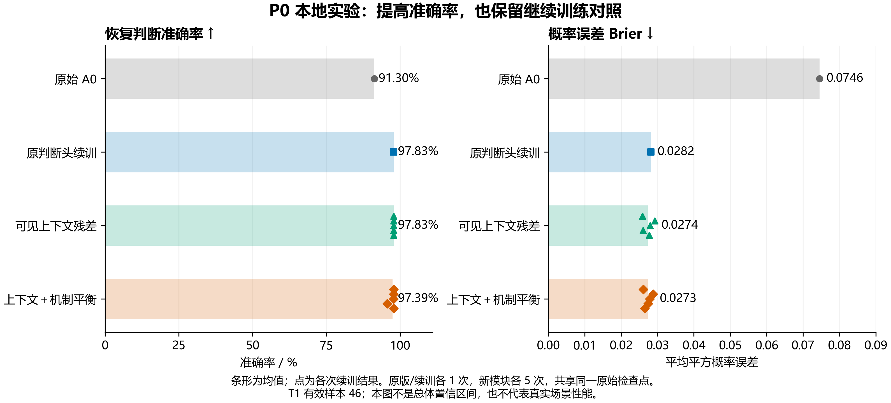
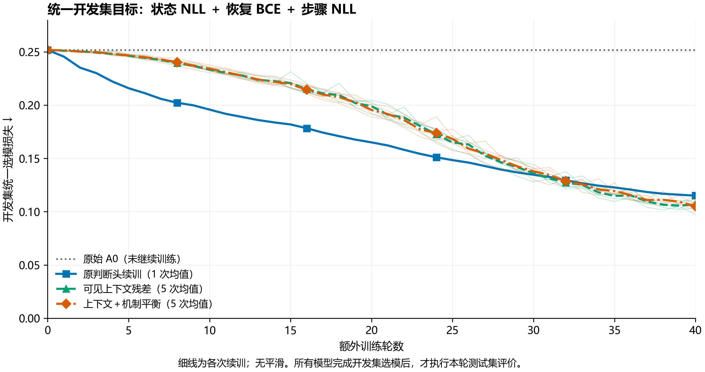

# Bill method: P0 context residual and continuation controls

This directory adds an isolated experiment to EC-JMF v3 A0. Existing model implementations, official checkpoints, data splits and evaluation code are unchanged. The experiment was run from commit `87a660b67be19dbd374b4709f7509f94871f9848`; original P0 v0.3 data and checkpoint hashes are recorded in `protocol.json`.

## Method

The original T1 head sees final structured state features. The context variant adds masked attention pooling over visible, valid person proposals, concatenates the final person memory and state features, and adds a bounded residual to the original hazard logit:

```text
context = concat(attention_pool(visible_valid_proposals), final_person_memory)
hazard_logit = original_head(state) + 2 * tanh(MLP(concat(state, context)))
```

The final residual layer starts at zero. Original parameters remain frozen; 1,993 new parameters are trained, for 20,370 total. T3 state probabilities remain unchanged. A separate `head_continue` control trains only the original 817-parameter T1 head, with the same additional 40 epochs. A further variant balances training BCE by mechanism frequency; mechanism labels are not inference inputs.

The original loss expression is retained. With the backbone frozen, state NLL and state regularizers are constant; the experiment optimizes the hazard and its indirect effect on conditional step mixing. The context pathway can use available evidence whose comprehension is uncertain, without changing the structured mental-state posterior. It is a behavioral prediction extension, not evidence of improved BCQ inference or reproduction of a named external paper.

## Results

Predeclared seed 0, fixed decision threshold 0.5:

| Method | T1 accuracy | False positives | False negatives | AUROC | Brier (lower is better) | Emitted T2 Top-1 |
|---|---:|---:|---:|---:|---:|---:|
| Original A0 | 91.30% | 4 | 0 | 0.9731 | 0.07456 | 100% |
| Original head continuation | 97.83% | 1 | 0 | 0.9923 | 0.02817 | 100% |
| Visible context residual | 97.83% | 1 | 0 | 0.9981 | 0.02592 | 100% |
| Context + mechanism balancing | 97.83% | 1 | 0 | 0.9981 | 0.02611 | 100% |

Both context variants were run with seeds 0–4 from the same original seed-0 backbone. Unweighted context accuracy is 97.83% for all five runs; mean Brier is 0.02738. The balanced variant averages 97.39% accuracy; seed 3 has an additional false negative and 95% emitted T2 Top-1. Conditional T2 Top-1 remains 100% for that run. These seeds measure continuation/module randomness, not independent full-model retraining.

The context variant was selected by mean dev loss before the terminal test phase (0.103746 versus balanced 0.104209 and continuation 0.115050). Canonical seed 0 was fixed beforehand. The 6.52 percentage-point accuracy increase over the original is also achieved by simple continuation; it cannot be attributed entirely to the new module.

Data: 254 scripted P0 examples, train/dev/test 150/52/52, disjoint story families 75/26/26. T1 test eligibility is 46 (20 positive, 26 negative; six uncertain examples excluded), T2 eligibility 20. This previously exposed P0 test is a diagnostic benchmark, not a fresh blind holdout or real-world generalization evaluation. T2 gold labels all match the first unfinished step, limiting its discrimination of planning capability.

Identifier renaming and insertion of 10/30 invisible semantic no-op events produce no T1 decision flips in any run. These transformations do not establish robustness to new causal events or complex long-horizon reasoning.

## Use from the repository root

Use an environment with the repository's neural requirements installed. The recorded run used Python/PyTorch versions listed in `protocol.json`, on CPU with one thread. No API key or paid LLM call is needed.

```bash
# Load the saved context model; display three dev predictions.
python experiments/bill_method/experiments/predict_local.py

# Load the simple continuation control.
python experiments/bill_method/experiments/predict_local.py --method head_continue

# Replay the fixed training plan in a fresh timestamped directory.
python experiments/bill_method/experiments/run_again.py
```

The prediction batch contains input only, not targets, family or mechanism labels. Local checkpoints use `c-local-context-diagnostic/v1`; load with this directory's `run_local.load_model`, not A's original checkpoint reader. The original source checkpoint is still needed to construct/verify the model and is already tracked in the repository.

## Artifacts

- `protocol.json`: historical pretraining protocol and hashes.
- `results/run_manifest.json`: all 12 predefined runs, selection, scores and stress results.
- `results/comparison.csv`, `method_summary.csv`: all-run and aggregate metrics.
- `results/mechanism_seed0.csv`, `error_comparison_seed0.csv`: mechanism and error diagnostics.
- `results/*/seed_*/`: exact checkpoints, training logs, public/native metrics and predictions.
- `results/figures/`: comparison and dev curves in PNG/SVG/PDF, with provenance.
- `experiments/code_audit.md`, `stress_design.md`: implementation checks and stress semantics.
- `packaging_provenance.json`: changes needed to run the isolated experiment inside the repository.





This package contains technical experiment artifacts only. Local full-repository archives, personal reports, Word documents, environment files and credentials are excluded.
